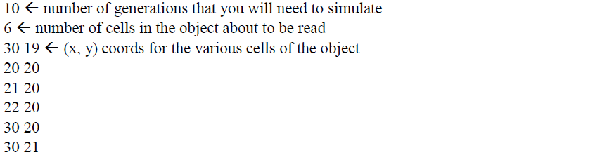
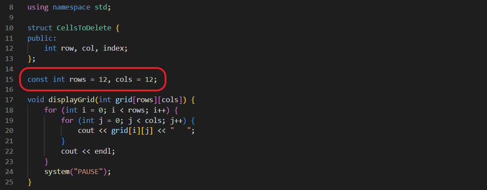
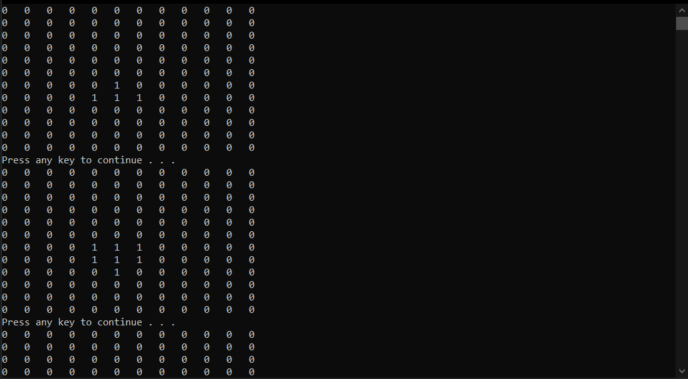

# Conway's Game of Life

A C++ console simulation of Conway's Game of Life. The program loads an initial grid from a text file and displays each generation using the standard birth, survival, and death rules.

[](https://github.com/SameetAsadullah/Game-of-Life/actions/workflows/quality.yml)

## Rules implemented

- A live cell with fewer than two live neighbours dies.
- A live cell with two or three live neighbours survives.
- A live cell with more than three live neighbours dies.
- A dead cell with exactly three live neighbours becomes alive.

## Build and run

```bash
cd src
g++ -std=c++17 -O2 Game.cpp -o game-of-life
./game-of-life
```

Run the executable from `src/` so it can read `data.txt`. On Windows, `src/GameOfLife.sln` can also be opened in Visual Studio.

## Input format

`src/data.txt` contains:

1. the number of generations to simulate;
2. the number of initially live cells;
3. one `row column` coordinate pair per live cell.

The original implementation uses a `12 x 12` grid. Change `rows` and `cols` in `src/Game.h` to experiment with another size.

```text
10
4
7 4
7 5
7 6
6 5
```

## Source layout

- `Game.cpp` — entry point and generation loop
- `Game.h` — grid loading, neighbour calculation, and transition rules
- `GridInfo.h` — live-cell coordinates
- `NeighboursInfo.h` — neighbour state used during a generation

## Screenshots

| Input format | Grid configuration | Simulation |
|---|---|---|
|  |  |  |

## Project status

This is a preserved university C++ exercise. The original simulation logic remains intact; generated Visual Studio output and vendored package binaries have been removed from the current branch.
